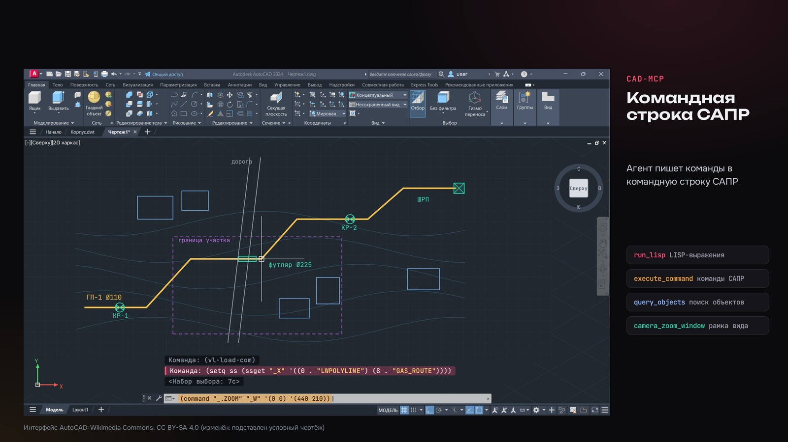
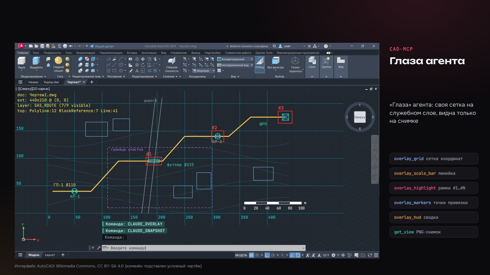

# ИИ-агент в AutoCAD и nanoCAD через MCP

Плагин для AutoCAD 2020 и nanoCAD 24.1 плюс MCP-сервер, через которые ИИ-агент (Claude Code, Codex) работает с открытым чертежом. Агент видит чертёж — получает PNG-снимок окна, сводку по слоям и блокам, находит объекты по фильтрам — и может вносить изменения командами САПР и LISP.

Запись в чертёж идёт только по двухфазной схеме: сначала агент получает план (dry-run) и показывает его пользователю, после подтверждения плагин делает резервную копию `.dwg` и выполняет команду одной группой UNDO. Несохранённый чертёж плагин править отказывается: резервную копию некуда было бы записать.

Прикладная задача, под которую делался инструмент, — проектирование газопроводов: агент извлекает трассу и блоки спецификации из чертежа для расчёта ведомости объёмов работ, проверяет чертёж на ошибки и собирает типовые листы.





<sub>Интерфейс AutoCAD на снимках: Wikimedia Commons, лицензия CC BY-SA 4.0 (изменён: подставлен условный чертёж).</sub>

## Что умеет агент

**Чтение и осмотр** — не меняют чертёж:
- `get_document_summary` — слои, блоки, счётчики объектов, габариты;
- `get_view` — PNG-снимок окна чертежа с метаданными;
- `query_objects` — поиск объектов по типу, слою, имени блока, рамке (условия через AND);
- `probe`, `healthz` — диагностика;
- только AutoCAD: `batch_capture`, `batch_capture_layouts` — пакет снимков зон и листов; `extract_so_blocks_from_route` — выгрузка полилиний трассы и блоков `СО_*` с атрибутами в JSON.

**«Глаза»** — пометки для снимка: `overlay_grid` (сетка координат), `overlay_highlight` (рамки вокруг объектов), `overlay_markers`, `overlay_scale_bar`, `overlay_hud`, `overlay_clear`. Всё рисуется на служебном слое `CLAUDE_OVERLAY`, который не печатается и стирается сразу после `get_view`.

**Камера**: `camera_zoom_extents`, `camera_zoom_window`.

**Запись**: `execute_command` (команда САПР) и `run_lisp` (LISP-выражение):
1. `confirm=false` (по умолчанию) — ничего не выполняется, возвращается план: точная команда, путь будущей резервной копии, предупреждения. Агент обязан показать план пользователю.
2. `confirm=true` — резервная копия `.dwg` в `%TEMP%\claude_bridge\backups\`, команда в группе `_UNDO _Begin/_End` (в AutoCAD; nanoCAD такой группы в командной строке не поддерживает, там откат — по резервной копии), LISP — внутри `vl-catch-all-apply`.
3. Для несохранённого документа запись отклоняется.

Резервная копия — это последнее сохранённое на диск состояние; выполнение асинхронное, поэтому ответ «dispatched», а результат агент проверяет следующим снимком или запросом.

Инструментов: 18 в AutoCAD, 15 в nanoCAD.

## Архитектура

```
ИИ-агент (Claude Code / Codex)
   │  MCP, stdio
   ▼
mcp-server (Node.js, TypeScript)
   │  HTTP, 127.0.0.1:7890
   ▼
плагин ClaudeBridge.* (C#, внутри САПР)
   │  API САПР, вызовы маршалятся в основной поток
   ▼
открытый чертёж .dwg
```

Плагин держит `HttpListener` только на `127.0.0.1`, наружу ничего не открыто. Обмен файлами (PNG, планы, резервные копии) — через `%TEMP%\claude_bridge`. В САПР доступны команды `CLAUDE_PING`, `CLAUDE_SUMMARY`, `CLAUDE_SNAPSHOT`, `CLAUDE_EXEC`, `CLAUDE_HTTP_START/STOP/STATUS` и другие.

| | AutoCAD | nanoCAD |
|---|---|---|
| Версия САПР | AutoCAD 2020 (R23.1) | nanoCAD Platform 24.1 |
| Платформа | .NET Framework 4.8 | .NET 6 (net6.0-windows) |
| API | accoremgd, acdbmgd, acmgd | hostmgd, hostdbmgd, nrxgatemgd |
| Инструментов MCP | 18 | 15 |

Версия для AutoCAD — форк версии для nanoCAD: архитектура, порт, контракт записи и имена команд общие, различается слой обёрток над API.

## Структура

```
src/AutoCad/          плагин для AutoCAD 2020 (C#, net48)
src/NanoCad/          плагин для nanoCAD 24.1 (C#, net6)
mcp-server/autocad/   MCP-сервер для AutoCAD (18 инструментов)
mcp-server/nanocad/   MCP-сервер для nanoCAD (15 инструментов)
scripts/autocad/      сборка и автозагрузка плагина в AutoCAD
scripts/nanocad/      сборка, автозагрузка и перезапуск nanoCAD
skills/               навыки агента (SKILL.md)
docs/                 изображения для README
```

Навыки в `skills/`:
- `getting-started` — первая проверка связи и первый снимок, разбор типовых сбоев;
- `safe-write-workflow` — порядок любой записи: план → подтверждение → копия → проверка;
- `check-drawing-health` — аудит чертежа (объекты «в бесконечности», пустые и замороженные слои и т. п.);
- `extract-pipe-spec-sheet` — подсчёт блоков вдоль выбранной трассы;
- `inspect-multilayout-dwg` — снимки чертежей с несколькими листами в пространстве модели;
- `bridge-write-ops-autocad` — проверенные паттерны записи через ActiveX/LISP (новый чертёж, вставка блоков, динамические блоки, атрибуты, кириллица).

## Сборка и установка (Windows)

Нужны .NET SDK 6 (см. `global.json`), Node.js 18+ и установленная САПР. Пути к сборкам API задаются в `.csproj` (`AutoCadRoot` / `NanoCadRoot`) и переопределяются свойством MSBuild.

Плагин:

```powershell
# AutoCAD 2020
powershell -ExecutionPolicy Bypass -File scripts\autocad\build.ps1
powershell -ExecutionPolicy Bypass -File scripts\autocad\install-autoload.ps1

# nanoCAD 24.1
powershell -ExecutionPolicy Bypass -File scripts\nanocad\build.ps1
powershell -ExecutionPolicy Bypass -File scripts\nanocad\install-autoload.ps1
```

Сборка кладёт DLL в `artifacts\ClaudeBridge.<САПР>\current\`. Без автозагрузки плагин подключается вручную: `NETLOAD` → `ClaudeBridge.AutoCad.dll` (или `ClaudeBridge.NanoCad.dll`). Проверка: команда `CLAUDE_HTTP_STATUS` в САПР или `curl http://127.0.0.1:7890/healthz`.

MCP-сервер:

```powershell
cd mcp-server\autocad   # или mcp-server\nanocad
npm install
npm run build
```

## Подключение к агенту

Claude Code:

```powershell
claude mcp add autocad-bridge -- node "<путь-к-репозиторию>\mcp-server\autocad\dist\index.js"
```

Codex (`~/.codex/config.toml`):

```toml
[mcp_servers.autocad-bridge]
command = "node"
args = ['<путь-к-репозиторию>\mcp-server\autocad\dist\index.js']
```

Навыки из `skills/` копируются в `.claude/skills/` (Claude Code) или `.agents/skills/` (Codex) рабочего проекта.

Переменные окружения MCP-сервера: `BRIDGE_URL` (по умолчанию `http://127.0.0.1:7890`), `BRIDGE_TIMEOUT_MS` (по умолчанию `35000`). Плагин nanoCAD может открывать чертёж при старте, если задана `CLAUDE_BRIDGE_DEFAULT_DRAWING`.

## Стек

C# / .NET Framework 4.8 и .NET 6, AutoCAD .NET API, nanoCAD .NET API (Teigha), Node.js, TypeScript, MCP SDK, zod, PowerShell.

## Автор

Telegram-канал [@sitimlab](https://t.me/sitimlab) · сайт [sitimlab.ru](https://sitimlab.ru/?utm_source=github&utm_medium=profile)

## Лицензия

MIT, см. [LICENSE](LICENSE). Снимки интерфейса AutoCAD в `docs/01-komandnaya-stroka.jpg` и `docs/02-glaza-agenta.jpg` под MIT не подпадают: они распространяются по CC BY-SA 4.0 (источник — Wikimedia Commons, см. подпись под изображениями).
